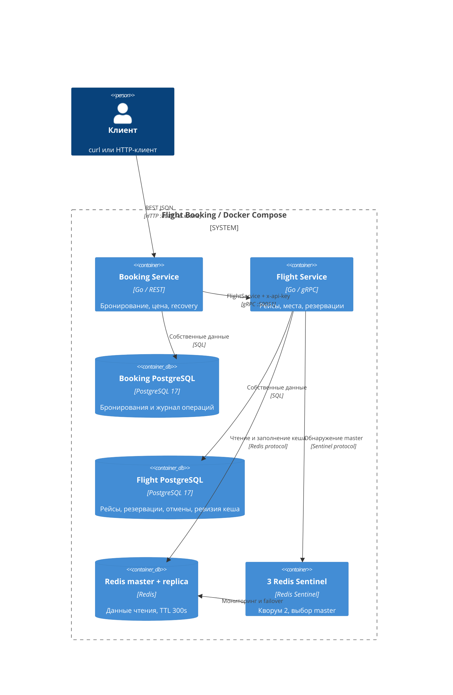
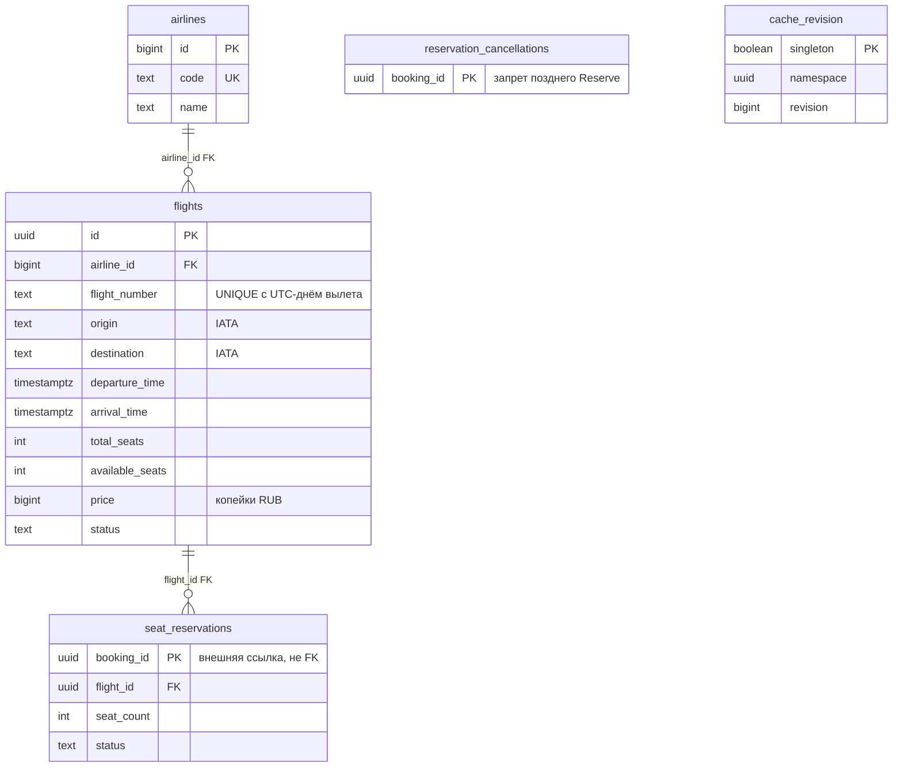
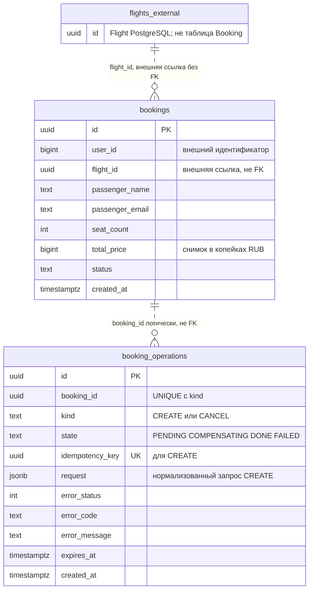

# Архитектура Flight Booking

Booking владеет бронированием и снимком стоимости, Flight — рейсом, остатком мест и резервацией. Сервисы обмениваются gRPC-сообщениями и не читают чужую БД. PostgreSQL хранит бизнес-данные и журнал восстановления; Redis ускоряет чтение и может временно отсутствовать.

## Границы и происхождение решения

В ДЗ-1 целевая архитектура маркетплейса разделяла Users, Catalog, Feed, Orders, Payments и Notifications: database-per-service, HTTP и Kafka. В ДЗ-2 [реализация маркетплейса](../../soa-marketplace/README.md) была одним Go HTTP-приложением с общей PostgreSQL. Новый проект не зависит от прежней реализации.

Здесь граница Orders переносится в Booking, а Catalog — во Flight: заказ владеет результатом покупки, каталог — предложением и доступным ресурсом. Предметная область и набор операций изменены по заданию. Вместо внутреннего HTTP используется gRPC. Общая локальная транзакция ДЗ-2 больше невозможна: две БД связывает журнал намерений и компенсация. Новый Go module собирает два исполняемых приложения; прежний репозиторий при сборке не нужен.



Compose запускает по одному экземпляру Booking и Flight. Миграции каждого сервиса выполняет отдельный Flyway-контейнер до запуска приложения. Межсервисный API key защищает все методы Flight; транспорт внутри учебной сети — plaintext, без TLS. Доступ конечного пользователя к REST в задании не моделируется.

## Данные и ограничения

### Flight PostgreSQL



### Booking PostgreSQL



Пунктир обозначает логическую связь: CREATE-намерение существует до записи бронирования, поэтому FK на bookings помешал бы восстановлению. Между БД нет FK: Booking.flight_id ссылается на Flight.flights.id, а Flight.seat_reservations.booking_id — на Booking.bookings.id только на уровне протокола. Для ещё не созданного бронирования резервация допустима временно.

Предметные таблицы приведены к 3NF: атрибуты авиакомпании вынесены из рейса, атрибуты резервации зависят от её booking_id. Коды IATA — атомарные значения; имён аэропортов и городов здесь нет, поэтому отдельный справочник не устранял бы транзитивную зависимость. Данные пассажира и total_price — снимок конкретного бронирования. JSON запроса в техническом журнале нужен для сравнения повторов и не заменяет предметные таблицы.

| Ограничение | Где закреплено |
|---|---|
| Один номер рейса на день вылета | UNIQUE-индекс с датой в UTC |
| Разные аэропорты, три заглавные буквы IATA | CHECK в flights |
| Прилёт позже вылета | CHECK по TIMESTAMPTZ |
| Цена и общее число мест положительны | CHECK в flights |
| Доступные места от нуля до общего числа | CHECK в flights |
| Один резерв на booking_id, число мест положительно | PK и CHECK в seat_reservations |
| Пользователь, места и итоговая стоимость положительны | CHECK в bookings |
| Допустимые статусы и состояния журнала | CHECK в соответствующих таблицах |
| Один CREATE и один CANCEL на бронирование | UNIQUE (booking_id, kind) |
| Один запрос на ключ идемпотентности | UNIQUE (idempotency_key) |

Цена — int64/BIGINT в копейках RUB: например, 150050 означает 1500,50 RUB. Здесь нужна только точная операция «цена × целое число мест», с проверкой переполнения. В ДЗ-2 decimal обслуживал скидки и денежные дроби; перенос этой зависимости для текущей арифметики не нужен. total_price фиксируется по GetFlight перед резервированием. Изменение тарифа между GetFlight и ReserveSeats не пересчитывает полученную цену.

Даты хранятся как TIMESTAMPTZ, передаются через protobuf Timestamp и RFC3339 в REST. День поиска и ограничение номера рейса с датой определены по UTC; часовой пояс аэропорта в расчёте не участвует. EXPIRED есть в enum и ограничении БД из задания; автоматического истечения резерваций нет, поскольку срок резерва не задан.

## Создание и восстановление

```mermaid
sequenceDiagram
    participant C as Клиент
    participant B as Booking
    participant BD as Booking PostgreSQL
    participant F as Flight
    participant FD as Flight PostgreSQL
    C->>B: POST /bookings + необязательный Idempotency-Key
    B->>BD: CREATE PENDING + request + booking_id; COMMIT
    B->>F: GetFlight
    F-->>B: Рейс и цена в копейках
    B->>F: ReserveSeats(booking_id, flight_id, count)
    F->>FD: Advisory lock booking_id; SELECT flight FOR UPDATE
    F->>FD: Уменьшить места + ACTIVE + revision; COMMIT
    F-->>B: Резерв
    alt Успешная финализация
        B->>BD: Lock journal; INSERT CONFIRMED + CREATE DONE; COMMIT
        B-->>C: 201 + бронирование
    else Ошибка или истёкшее незавершённое намерение
        B->>BD: CREATE COMPENSATING
        B->>F: ReleaseReservation(booking_id), с повторами
        F->>FD: Tombstone + возврат ACTIVE + RELEASED + revision; COMMIT
        B->>BD: CREATE FAILED
        Note over B,FD: Recovery продолжает после перезапуска Booking
        B->>F: Возможный поздний ReserveSeats с тем же booking_id
        F->>FD: Проверить durable tombstone под тем же advisory lock
        F-->>B: FAILED_PRECONDITION, места не заняты
    end
```

Ни одна локальная SQL-транзакция не остаётся открытой во время gRPC. В Flight изменение остатка и резерва — одна транзакция с блокировкой строки рейса. Advisory lock по booking_id сериализует Reserve и Release, включая случай отсутствующей резервации. Release всегда сохраняет запрет на будущий Reserve с этим ID. Запреты и журнал не имеют TTL: удаление без согласованной политики повторов вернуло бы риск позднего резервирования.

В Booking создание записи и переход CREATE в DONE коммитятся вместе. Recovery сканирует COMPENSATING и просроченные PENDING при старте и далее раз в секунду. Просроченный CREATE компенсируется. Журнал блокируется при финализации и выборе просроченной операции, поэтому завершённый CREATE не попадает под компенсацию.

Отмена сохраняет CANCEL-намерение до ReleaseReservation. После возврата мест Booking одной транзакцией ставит CANCELLED и CANCEL DONE. Если процесс упал между этими шагами, recovery повторяет Release и завершает отмену. Это движение вперёд: возвращённые места повторно не резервируются. До восстановления клиент может временно прочитать CONFIRMED при уже освобождённом резерве.

При ошибке ответа COMMIT нельзя считать, что запись точно откатилась. Для финализации CREATE возвращается UNKNOWN_OUTCOME: повтор с тем же ключом прочитает журнал. Если COMMIT состоялся, DONE вернёт сохранённое бронирование; если нет — оставшееся PENDING позже компенсируется. Состояния двух БД сходятся после сбоя; мгновенной распределённой атомарности нет. Прогресс требует восстановления доступности сервисов и БД и сохранности PostgreSQL volumes.

## Кеш и Redis Sentinel

Ключи имеют вид:

```text
flight:<namespace UUID>:<revision>:<flight UUID>
search:<namespace UUID>:<revision>:<origin>:<destination>:<date>
```

Перед чтением Redis Flight получает namespace и revision из PostgreSQL. Далее данные читаются по схеме Cache-Aside: hit возвращает кеш, miss читает рейс или поиск из БД и записывает JSON с TTL 300 секунд. Логи содержат cache hit/miss и сбои кеша.

Каждая мутация UpdateFlight, ReserveSeats или действующий ReleaseReservation увеличивает revision в той же транзакции, что и данные. Новое чтение после COMMIT использует новую версию ключа. Даже поздняя запись старого результата заполняет только старую версию. Старые ключи физически остаются до TTL, но для новых чтений недоступны; DEL не выполняется. UUID namespace защищает от совпадения версии после создания новой БД при сохранённом Redis.

Это осознанное отступление от буквального «сначала только кеш» в задании: даже hit требует короткого SELECT в PostgreSQL. Взамен инвалидация переживает недоступность Redis, failover и потерянный ответ COMMIT без отдельной очереди. Кеш экономит чтение и сборку payload, но не позволяет обслуживать запросы при отказе PostgreSQL. Общая revision инвалидирует все рейсы и поиски, что приемлемо для учебной нагрузки; она же сериализует мутации на одной строке.

Redis-клиент использует Sentinel-aware NewFailoverClient: master + replica, три Sentinel, кворум 2. Sentinel выбирает новый master, приложение обнаруживает его адрес. Переключение занимает время, репликация Redis асинхронная и не гарантирует сохранность последних кеш-записей. PostgreSQL остаётся источником истины; ошибки Redis переводят чтение на БД. Эта конфигурация не делает отказоустойчивыми PostgreSQL и сами приложения.

## Retry, deadlines и circuit breaker

Один клиентский gRPC interceptor добавляет API key, общий deadline, retry и breaker. Встроенные retry gRPC отключены, чтобы не умножать число попыток. По умолчанию максимум три попытки, паузы 100 и 200ms, 500ms на попытку, 2s на логический RPC. Повторяются только UNAVAILABLE и DEADLINE_EXCEEDED; бизнес-ошибки завершаются сразу. Reserve идемпотентен по booking_id и параметрам, Release — по booking_id.

Breaker общий для методов одного target. Он считает окончательный исход логического RPC после retry: пять последовательных инфраструктурных ошибок в окне 60s открывают цепь на 15s. Успех или бизнес-ответ обнуляет счётчик. В HALF_OPEN допускается один вызов без retry; остальные получают быструю ошибку. Успешная связь закрывает цепь, инфраструктурная ошибка открывает снова. Поколение состояния не позволяет позднему результату старого вызова изменить новое состояние. Переходы пишутся в JSON-логи.

OPEN преобразуется в REST 503; истёкший RPC deadline — в 504. Ограничение времени HTTP не отменяет долговечное намерение в БД: его завершает recovery.

В [документации Avito service-item](https://docs.k.avito.ru/service-item/circuit_breaker/) circuit breaker защищает исходящий HTTP-клиент. Здесь применяется тот же принцип ограничения обращений к недоступной зависимости, но в gRPC interceptor. Протокол и учебные пороги этого проекта не описывают продакшен-настройки Avito.
