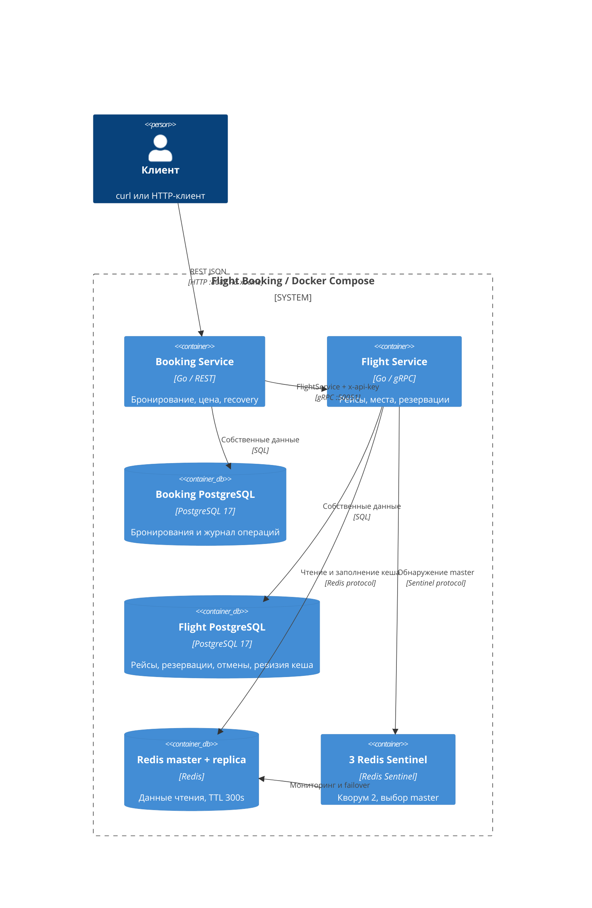
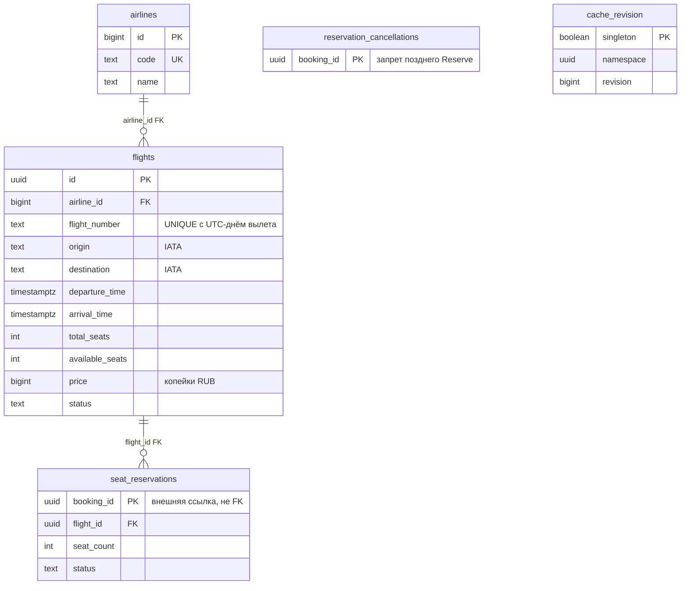
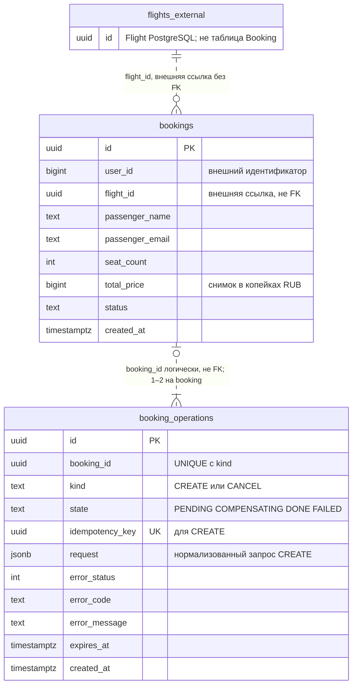

# Архитектура Flight Booking

Booking владеет бронированием и снимком цены; Flight — рейсами, местами и резервациями. Сервисы используют gRPC и отдельные PostgreSQL. Redis — необязательный кеш.

## Границы сервисов

ДЗ-1: Users, Catalog, Feed, Orders, Payments, Notifications, отдельные БД, HTTP/Kafka. ДЗ-2: Go HTTP-монолит, общая PostgreSQL. Здесь Orders/Catalog соответствуют Booking/Flight; авиабилеты и gRPC заданы условием. Общую транзакцию заменяют журнал и компенсация. Оба приложения собираются независимо от прежнего репозитория.



Compose: по одному приложению, две PostgreSQL, Flyway-миграции перед стартом. Все методы Flight требуют API key; gRPC — plaintext без TLS. REST без аутентификации пользователя.

## Схема данных

### Flight PostgreSQL



### Booking PostgreSQL



Пунктир — связь без FK: намерение CREATE и резерв могут предшествовать booking, PENDING/неудачный CREATE — остаться без него. Ссылки между БД проверяются протоколом; UNIQUE (booking_id, kind) допускает один CREATE/CANCEL.

3NF: авиакомпания отделена от рейса, резерв зависит от booking_id. IATA атомарен, справочных имён аэропортов нет. Пассажир/total_price — снимок покупки; JSON журнала сравнивает повторы.

| Ограничение | Механизм PostgreSQL |
|---|---|
| Номер рейса уникален за день UTC | UNIQUE-индекс |
| Аэропорты различаются; IATA — три заглавные буквы | CHECK |
| Прилёт позже вылета | CHECK по TIMESTAMPTZ |
| Цена/число мест положительны; остаток от нуля до общего числа | CHECK в flights |
| Один резерв на booking_id; число мест положительно | PK, CHECK |
| user_id, места и итоговая стоимость положительны | CHECK в bookings |
| Статусы и состояния из допустимого набора | CHECK |
| Один CREATE/CANCEL; один запрос на ключ идемпотентности | UNIQUE (booking_id, kind), UNIQUE (idempotency_key) |

Цена — int64/BIGINT, копейки RUB: 150050 = 1500,50 RUB. Цена × места: проверка переполнения. Decimal ДЗ-2 нужен для скидок/дробей; здесь достаточно целых. Бронь фиксирует цену GetFlight перед ReserveSeats, даже при одновременной смене тарифа.

Даты: TIMESTAMPTZ → protobuf Timestamp / REST RFC3339. Поиск/UNIQUE номера рейса — по дню UTC, без зоны аэропорта. EXPIRED есть в контракте/БД; автоистечения нет: срок удержания не задан.

## Транзакции и восстановление

```mermaid
sequenceDiagram
    participant C as Клиент
    participant B as Booking
    participant BD as Booking PostgreSQL
    participant F as Flight
    participant FD as Flight PostgreSQL
    C->>B: POST /bookings + необязательный Idempotency-Key
    B->>BD: CREATE PENDING + request + booking_id; COMMIT
    B->>F: GetFlight
    F-->>B: Рейс и цена в копейках
    B->>F: ReserveSeats(booking_id, flight_id, count)
    F->>FD: Advisory lock booking_id; SELECT flight FOR UPDATE
    F->>FD: Уменьшить места + ACTIVE + revision; COMMIT
    F-->>B: Резерв
    alt Успешная финализация
        B->>BD: Lock journal; INSERT CONFIRMED + CREATE DONE; COMMIT
        B-->>C: 201 + бронирование
    else Ошибка или истёкшее незавершённое намерение
        B->>BD: CREATE COMPENSATING
        B->>F: ReleaseReservation(booking_id), с повторами
        F->>FD: Tombstone + возврат ACTIVE + RELEASED + revision; COMMIT
        B->>BD: CREATE FAILED
        Note over B,FD: Recovery продолжает после перезапуска Booking
        B->>F: Возможный поздний ReserveSeats с тем же booking_id
        F->>FD: Проверить durable tombstone под тем же advisory lock
        F-->>B: FAILED_PRECONDITION, места не заняты
    end
```

SQL-транзакции закрываются до gRPC. В Flight блокировка рейса защищает атомарное изменение остатка/резерва; advisory lock booking_id сериализует Reserve/Release даже без резервации. Release сохраняет tombstone, запрещающий будущий Reserve. Журнал/tombstone без TTL: удаление требует политики срока повторов.

Booking коммитит CONFIRMED и CREATE DONE вместе. Recovery при старте и каждую 1s выбирает COMPENSATING/просроченные PENDING (OPERATION_TIMEOUT=10s); CREATE компенсируется. Блокировка журнала при финализации/recovery защищает завершённые брони от компенсации.

Отмена: CANCEL-намерение → Release → атомарно CANCELLED + CANCEL DONE. После падения recovery повторяет Release, завершая отмену без нового резерва. До сходимости возможен CONFIRMED с освобождёнными местами.

Ошибка подтверждения COMMIT не означает rollback: 503 UNKNOWN_OUTCOME требует прежнего ключа. DONE возвращает бронь, PENDING позже компенсируется. Сходимость требует доступности сервисов/БД и сохранности PostgreSQL volumes; распределённой атомарности нет.

COMMIT-тесты возвращают driver.ErrBadConn после настоящего коммита: Booking повторяет CONFIRMED без Release, Flight после UNAVAILABLE не списывает места/revision повторно. Проверена граница драйвера; обрыв TCP не воспроизводится.

## Кеш и Sentinel

```text
flight:<namespace UUID>:<revision>:<flight UUID>
search:<namespace UUID>:<revision>:<origin>:<destination>:<date>
```

Flight читает namespace/revision из PostgreSQL, затем Redis: hit возвращает JSON, miss заполняет кеш из БД, TTL 300s. Hit/miss и ошибки логируются.

UpdateFlight, ReserveSeats, действующий Release увеличивают revision вместе с данными. После COMMIT чтение использует новый ключ; поздний SET — выбранный до чтения. Старые ключи остаются до TTL, без DEL. UUID namespace разделяет версии новой БД и сохранённого Redis.

GET/SET: отдельные бюджеты 50ms, context deadline, без retry; сетевые/pool timeouts — 50ms. Ошибка ведёт к PostgreSQL fallback.

Отступление от cache-first: даже hit требует PostgreSQL. Взамен инвалидация переживает отказ Redis, failover, неизвестный COMMIT. Общая revision инвалидирует все рейсы/поиски и сериализует мутации на одной строке. Кеш экономит чтение payload, но не заменяет БД.

NewFailoverClient обнаруживает master через три Sentinel, кворум 2. Failover не мгновенен; асинхронная репликация допускает потерю кеша. Источник истины — PostgreSQL. БД и приложения не реплицированы.

## Retry и circuit breaker

Interceptor: API key, deadline, retry, breaker:

| Параметр | По умолчанию |
|---|---|
| RPC_ATTEMPTS / RPC_BACKOFF | До 3 вызовов invoker; паузы 100ms, 200ms |
| RPC_ATTEMPT_TIMEOUT / RPC_TIMEOUT | 500ms на попытку, 2s на логический RPC |
| CB_FAILURE_THRESHOLD / CB_WINDOW | 5 последовательных инфраструктурных ошибок за 60s |
| CB_OPEN_TIMEOUT | OPEN на 15s, затем один HALF_OPEN probe |
| HTTP_TIMEOUT | 8s на контекст обработки и server ReadTimeout |

Повторяются UNAVAILABLE и DEADLINE_EXCEEDED; бизнес-ошибки завершаются сразу. Reserve идемпотентен по booking_id и параметрам, Release — по booking_id. WithDisableRetry отключает service-config retry; в gRPC 1.85.0 остаётся transparent retry ещё не обработанного сервером запроса. Число вызовов invoker ограничивает попытки приложения, не сетевые передачи.

Breaker общий для методов одного target и учитывает итог RPC после retry. Успех/бизнес-ответ сбрасывает счётчик. HALF_OPEN допускает один probe без retry приложения; остальным — быстрая ошибка. Transparent retry сохраняется. Успех закрывает цепь, инфраструктурная ошибка открывает. Поколение состояния отсекает поздние результаты; переходы логируются в JSON.

OPEN даёт REST 503, RPC deadline — 504. HTTP_TIMEOUT ограничивает также чтение неполного тела. Синхронная компенсация получает отдельный background-бюджет, поэтому полный ответ может длиться дольше 8s. Истечение HTTP-контекста не удаляет намерение: его завершает recovery.

В [документации Avito service-item](https://docs.k.avito.ru/service-item/circuit_breaker/) breaker защищает исходящий HTTP-клиент; здесь — gRPC interceptor. Аналогия ограничена принципом, без переноса продакшен-протокола и порогов.
